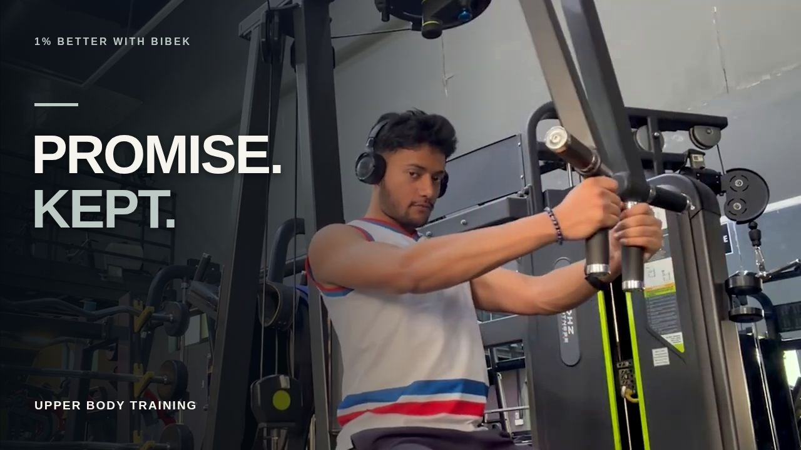

# Gym Video Edits

## I Kept a Promise to Myself Today

A three-minute upper-body training edit for 1% Better with Bibek.

**[Download the finished MP4](https://github.com/GrowthQuestHero/gym-video-edits/raw/refs/heads/main/episode-promise/I_Kept_a_Promise_Final.mp4)**

- [Cover](episode-promise/Promise_Cover.jpg)
- [15-second preview](episode-promise/Promise_Preview.mp4)
- [Brief, cut plan, cover and YouTube packaging ZIP](episode-promise/Episode_Notes_and_Cover.zip)
- [YouTube title and description](episode-promise/YouTube_Packaging.md)
- [QC report](episode-promise/QC_Report.md)
- [Audio credits](episode-promise/Audio_Credits.md)

## Three workout thumbnails

All three are distinct real frames from the completed episode, verified as 1280×720 JPGs. The original final video and existing cover are unchanged.

- [Download Thumbnail_01.jpg — barbell bench press](https://github.com/GrowthQuestHero/gym-video-edits/raw/refs/heads/main/episode-promise/Thumbnail_01.jpg)
- [Download Thumbnail_02.jpg — incline dumbbell press](https://github.com/GrowthQuestHero/gym-video-edits/raw/refs/heads/main/episode-promise/Thumbnail_02.jpg)
- [Download Thumbnail_03.jpg — machine fly](https://github.com/GrowthQuestHero/gym-video-edits/raw/refs/heads/main/episode-promise/Thumbnail_03.jpg)

[Dimensions and source-frame verification](episode-promise/Thumbnail_Manifest.json)

The final is 1280×720, 30 fps, 5,400 frames, 3:00. Full decode and sampled visual review passed. The music-only mix measures −18.08 LUFS / −2.95 dB true peak, with zero clipped samples. Exactly one preview and one final video were rendered. No video has been published to YouTube.

Downloads from a private repository require signing into a GitHub account with access. Open the MP4 file page and choose **Download raw file** if the direct link does not download automatically.

The larger editable project remains in the cloud workspace pending a suitable transfer route. It is not included in this repository upload because its 178 MB archive exceeds GitHub's single-file limit.
